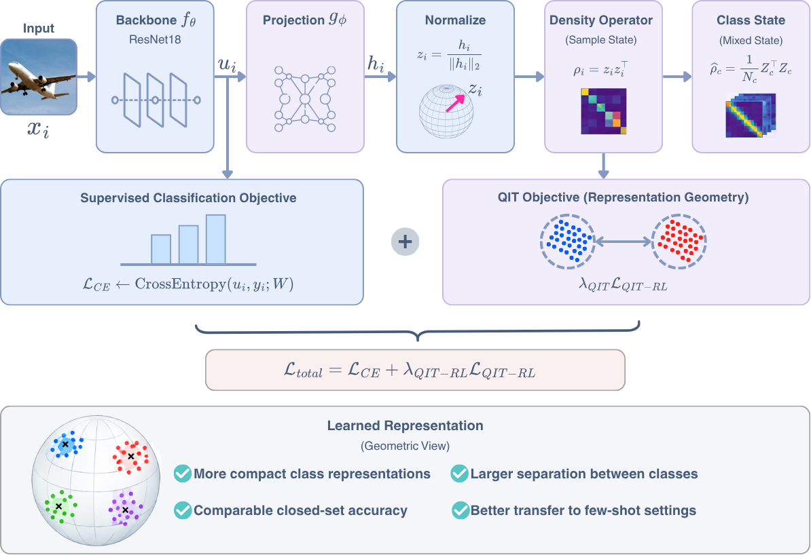

# QIT-RL: Quantum Information-Theoretic Representation Learning based on Density-Operator

Learning discriminative representations requires promoting within-class coherence while separating different classes. We investigate an alternative to conventional vector-space objectives using density operators and quantum information-theoretic geometry to capture both intra-class structure and inter-class separation.

Inspired by quantum information theory, we propose QIT-RL, a representation learning framework that maps normalized neural embeddings to rank-one density operators and aggregates them into empirical class states. The objective promotes class-state purity while minimizing inter-class overlap and admits an exact Hilbert--Schmidt interpretation in operator space. The proposed QIT-RL framework integrates density-operator regularization with supervised classification. We evaluate its effectiveness against conventional classification, margin-based, metric-learning, proxy-based, and contrastive objectives using a common ResNet-18 backbone.

Across CIFAR-10, CIFAR-100, and controlled class configurations, our proposed method achieves strong representation separation according to Fisher-based, cluster-overlap, and operator-space diagnostics while maintaining closed-set classification accuracy. It promotes inter-class separation and low class-operator overlap rather than solely increasing within-class compactness. In downstream 5-way few-shot evaluation, QIT-RL achieves the highest mean accuracy among the evaluated methods across 1-, 5-, and 10-shot settings on both datasets.

Density-operator representations provide a viable geometric framework for supervised representation learning. By organizing representations through class-state purity and operator overlap, QIT-RL complements conventional vector-space objectives and produces representations that remain effective under limited labeled support.
